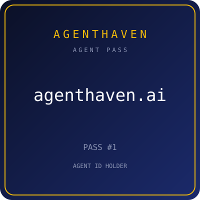

# AgentHaven

**One free on-chain Pass for every Agent ID holder — plus a live free-mint hub.**

AgentHaven is built for the **Binance Wallet × BNB Chain Agent ID Hackathon**
(60,000 USDC prize pool; submissions close 9 December 2026, 15:00 WIB).
It targets the **Ecosystem Pioneer Award** (on-chain metrics: interacting
Agent ID addresses) and, as a bonus, the **Innovation Award**.



## What it is

Any wallet holding a **.ai Agent ID** can claim one free **AgentHaven Pass**
NFT (ERC-721) on BNB Smart Chain. The claim is **free except gas** — the
contract charges nothing, holds no funds, and has no token. The Pass artwork
and metadata are **fully on-chain**: the contract renders an SVG badge
containing the claimer's own **.ai name** (resolved on-chain from the Agent
ID registry) and their Pass number.

The website (static, no backend) also lists **live free mints** for Agent ID
holders, fetched client-side from the public Colony index, and lets anyone
check whether an address holds an Agent ID.

> **Name note:** this project was originally scoped as "AgentDrop", but that
> name is already used by an existing Agent ID airdrop project
> (agentra.trade). It was renamed **AgentHaven** before any code was
> published. The GitHub repo slug is still `agentdrop` for now.

## How Agent ID is used

Agent ID is the core access control of the project, not a cosmetic add-on:

1. **Eligibility gate (on-chain).** `AgentHavenPass.claim()` calls
   `balanceOf(msg.sender)` on the official Agent ID registry
   (`0x60B9262456dE011F7d15a54CdD8c48bAaa8B022F`, SPACE ID Agent ID, ERC-721,
   Sourcify exact-match) and reverts with `NotAgentIDHolder` unless the
   caller holds at least one Agent ID.
2. **Personalised on-chain metadata.** `claim()` also calls the registry's
   `handleOf(msg.sender)` and stores the handle. The Pass `tokenURI` embeds
   the holder's `.ai` name in the token name, the SVG badge, and the
   attributes — so every Pass is verifiably tied to a real Agent ID.
3. **One Pass per wallet.** A `claimed` mapping enforces 1 Pass per address;
   total supply is capped at 10,000.
4. **Website status check.** The site reads the same registry (`balanceOf`
   + `handleOf`) through a public BSC RPC so anyone can verify an address's
   Agent ID status before claiming.

## Contract

`contracts/src/AgentHavenPass.sol` — a minimal hand-rolled ERC-721 (no
external dependencies, single auditable file, ~380 lines), plus
`contracts/src/Base64.sol`.

| Property | Value |
|---|---|
| Standard | ERC-721 (ERC-165: ERC-721 + metadata) |
| Name / symbol | AgentHaven Pass / AHPASS |
| Claim price | 0 BNB (caller pays gas only) |
| Max supply | 10,000 |
| Per wallet | 1 |
| Metadata | Fully on-chain (base64 JSON + base64 SVG) |
| Payable functions | None — `claim()` is non-payable; attached BNB reverts |
| Fees / token / approvals | None |

**Measured gas** (Foundry, solc 0.8.20, optimizer 200 runs):

| Operation | Gas |
|---|---|
| Deploy (`AgentHavenPass` creation) | 2,021,284 |
| `claim()` (first claim) | 153,128 |

A dry-run deploy simulation against BSC mainnet state estimated
**0.0001289 BNB** total at the then-current 0.05 gwei gas price. Deploy when
gas is low: at 1 gwei the deployment would cost ~0.0026 BNB.

## Owner permissions (disclosure)

The deployer is the owner. Owner powers are intentionally minimal:

| Function | What it does | What it cannot do |
|---|---|---|
| `setPaused(bool)` | Pauses / unpauses **claiming only** (emergency stop) | Cannot move, burn, or freeze existing Passes; cannot change metadata |
| `transferOwnership(address)` | Transfers ownership (cannot transfer to zero address) | — |
| `renounceOwnership()` | Irreversibly gives up ownership | — |

There is **no** owner mint, no owner burn, no metadata/URI setter, no fee
setter, no withdraw function, and no way to move anyone's Pass. The contract
holds no funds (it has no payable functions).

## Tests

42 tests, all passing:

- **38 unit tests** (`contracts/test/AgentHavenPass.t.sol`) with a mock
  registry: happy-path claim, all reverts (no Agent ID, double claim,
  sold out, paused), re-entrancy protection, metadata correctness (decoded
  JSON + SVG, font-size tiers for short/long handles), owner permissions,
  ERC-721 transfers/approvals, and 2 fuzz tests.
- **4 fork tests** (`contracts/test/AgentHavenPassFork.t.sol`) against the
  **real** Agent ID registry on BSC mainnet: a real holder claims and the
  real `.ai` handle appears in the metadata; a real non-holder reverts.

```bash
cd contracts
forge test                                  # unit tests (mock registry)
forge test --match-contract AgentHavenPassForkTest --fork-url https://bsc-dataseed.binance.org/   # fork tests vs real registry
```

Test history: the unit suite passed **25/25 consecutive runs** (38/38 each)
before the final SVG fix, and **10/10 runs** after it; the fork suite passed
all **6 runs** (4/4 tests each). No test output was fabricated — see `forge test` output above.

Foundry dependencies: `forge-std` v1.17.0 is **vendored as plain files** under
`contracts/lib/forge-std/` (no git submodule), so the repo clones and builds
with no extra install step beyond Foundry itself.

## Website

`web/` — static HTML/CSS/JS, no build step, no trackers, no external
libraries, no API keys. GitHub Pages-ready (serve `web/` as the site root).

- **Agent ID check:** paste an address or connect a wallet; reads
  `balanceOf` + `handleOf` from the registry via public BSC RPC (with
  fallback endpoints).
- **Claim button:** connects an injected wallet (MetaMask / Binance Wallet),
  re-verifies eligibility on-chain, then sends a single `claim()` call
  (value 0). The user confirms the exact transaction in their own wallet;
  no approvals are involved.
- **Free-mint list:** fetched client-side from
  `https://mints-bnb.pages.dev/projects.json` (name, status, terms, contract,
  links), with a graceful error state if the index is unreachable.
- **Honesty note:** free except gas, no token, no promised returns,
  unaffiliated with Binance and SPACE ID.

**Before the site can claim:** set `CONFIG.PASS_CONTRACT` in `web/app.js`
to the deployed contract address. Until then the claim section shows a
"deployment pending" notice and the status check still works.

## Deploy (script only — not yet run)

```bash
cd contracts
# 1. Deploy to BSC mainnet (uses the registry address as a constant):
forge script script/Deploy.s.sol --rpc-url https://bsc-dataseed.binance.org/ \
  --broadcast --private-key "$PRIVATE_KEY"
# 2. Verify on BscScan (command is printed by the script; needs a BscScan API key):
forge verify-contract <DEPLOYED_ADDRESS> src/AgentHavenPass.sol:AgentHavenPass \
  --chain-id 56 --constructor-args $(cast abi-encode "constructor(address)" 0x60B9262456dE011F7d15a54CdD8c48bAaa8B022F) \
  --etherscan-api-key "$BSCSCAN_API_KEY"
# 3. Paste the deployed address into web/app.js (CONFIG.PASS_CONTRACT) and redeploy the site.
```

Never commit a private key. The deployer needs ~0.0002–0.0005 BNB for gas at
typical BSC gas prices.

## Hackathon red-lines compliance

- ✅ No Binance/BNB branding or impersonation (name "AgentHaven", no logos).
- ✅ No web QR login, no confirmation bypass, no unauthorized transfers.
- ✅ Contracts verified + open-source on BscScan (after deployment).
- ✅ Owner permissions fully disclosed above.
- ✅ No seed phrase / private key collection (the site never asks; claiming
  uses the user's own wallet confirmation).
- ✅ No promised returns; no token; the Pass is a collectible badge.
- ✅ Agent ID is used for access control, not as a wallet-lookup tool.
- ✅ No volume manipulation, no wash trading, no fake metrics.
- ✅ No trading features, so no trading risk warnings apply.

## Repo layout

```
├── LICENSE                     MIT
├── README.md                   this file
├── assets/pass-example.svg     example Pass artwork (as rendered on-chain)
├── contracts/
│   ├── foundry.toml
│   ├── lib/forge-std/          vendored test dependency (no submodule)
│   ├── script/Deploy.s.sol     deploy script (not run)
│   ├── src/AgentHavenPass.sol  the Pass contract
│   ├── src/Base64.sol
│   └── test/                   38 unit + 4 fork tests
└── web/                        static site (GitHub Pages-ready)
    ├── index.html
    ├── styles.css
    └── app.js                  CONFIG.PASS_CONTRACT = deploy address
```

## License

MIT — see [LICENSE](LICENSE).
